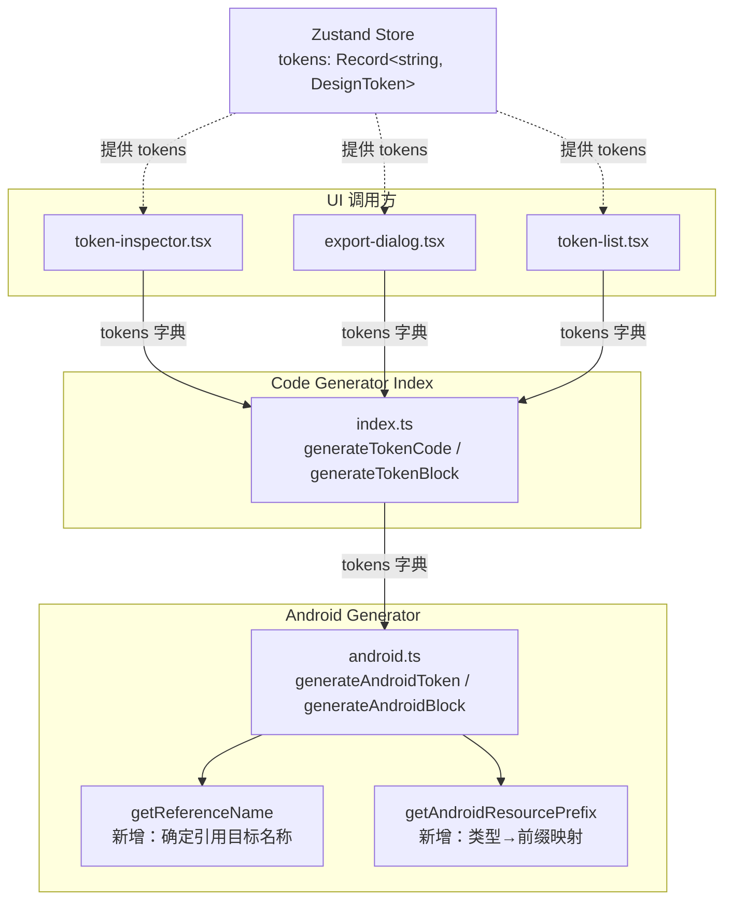
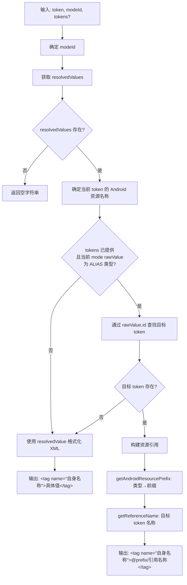

# Design Document: Android 别名资源引用

## Overview

当前 Android 代码生成器（`android.ts`）对所有 token 统一使用 `resolvedValues` 输出最终解析值。这意味着别名 token（如 `primary_light → blue_light_level1`）会直接输出 `#1A73E8` 这样的具体颜色值，而非 Android 开发中惯用的 `@color/blue_light_level1` 资源引用格式。

本次改进的核心目标：让别名 token 在 Android XML 输出中保留资源引用关系，生成 `@color/xxx`、`@dimen/xxx`、`@string/xxx`、`@bool/xxx` 格式的引用值。非别名 token 行为不变。

改动范围小且集中：主要修改 `android.ts` 中的生成逻辑，扩展 `index.ts` 的函数签名以传递 token 字典，以及在三个 UI 调用方中补充 tokens 参数。

## Architecture

### 改动架构概览



### 设计决策

1. **可选参数设计**：`tokens` 字典作为可选参数传入，未提供时回退到当前行为（输出解析值）。这保证了向后兼容性，不会破坏现有调用。

2. **只引用直接目标**：对于多级别名链 A → B → C，A 的输出为 `@color/B` 而非 `@color/C`。通过读取当前 mode 的 `rawValues` 获取直接引用目标 ID，而非使用已经递归解析过的 `resolvedValues`。

3. **引用名称派生复用现有逻辑**：引用目标的 Android 资源名称使用与当前 `generateAndroidToken` 相同的命名规则（`codeSyntax.ANDROID` 优先，否则从 `name` 派生），确保引用名称与目标 token 自身输出的资源名称一致。

## Components and Interfaces

### 修改的函数签名

#### `android.ts`

```typescript
// 新增：类型到 Android 资源前缀的映射
function getAndroidResourcePrefix(type: TokenType): string;
// 返回: "color" | "dimen" | "string" | "bool"

// 新增：获取引用目标的 Android 资源名称
function getReferenceName(
  targetToken: DesignToken
): string;
// 使用 codeSyntax.ANDROID（经 stripCodeSyntaxPrefix 处理）或从 name 派生

// 修改：增加可选 tokens 参数
export function generateAndroidToken(
  token: DesignToken,
  modeId?: string,
  tokens?: Record<string, DesignToken>  // 新增
): string;

// 修改：增加可选 tokens 参数
export function generateAndroidBlock(
  tokenList: DesignToken[],
  modeId?: string,
  tokens?: Record<string, DesignToken>  // 新增
): string;
```

#### `index.ts`

```typescript
// 修改：增加可选 tokens 参数
export function generateTokenCode(
  token: DesignToken,
  format: CodeFormat,
  modeId?: string,
  tokens?: Record<string, DesignToken>  // 新增
): string;

// 修改：增加可选 tokens 参数
export function generateTokenBlock(
  tokenList: DesignToken[],
  format: CodeFormat,
  modeId?: string,
  tokens?: Record<string, DesignToken>  // 新增
): string;
```

### `generateAndroidToken` 核心逻辑流程



### UI 调用方修改

三个 UI 组件的修改方式一致：从 Zustand store 获取 `tokens` 字典，传递给 `generateTokenCode` 或 `generateTokenBlock`。

| 组件 | 调用函数 | 修改内容 |
|------|---------|---------|
| `token-inspector.tsx` | `generateTokenCode(token, codeFormat, modeId)` | 追加第四参数 `tokens` |
| `export-dialog.tsx` | `generateTokenBlock(visibleTokens, format, ...)` | 追加第四参数 `tokens` |
| `token-list.tsx` | `generateTokenCode(token, codeFormat, modeId)` | 追加第四参数 `tokens` |

## Data Models

### 现有数据模型（无需修改）

本功能不引入新的数据模型。所有需要的信息已存在于 `DesignToken` 类型中：

- `token.rawValues[modeId]` — 当 `type === "ALIAS"` 时包含 `{ type: "ALIAS", id: string }`，`id` 指向直接引用目标
- `token.isAlias` — 标记是否为别名 token（任意 mode 下）
- `token.type` — 用于确定 Android 资源前缀（COLOR → `@color/`，NUMBER → `@dimen/` 等）
- `token.codeSyntax?.ANDROID` — 可选的 Android 平台代码语法名称
- `token.name` — 用于在无 codeSyntax 时派生 Android 资源名称

### 类型到 Android 资源前缀映射

| TokenType | Android 资源前缀 | XML 标签 |
|-----------|-----------------|---------|
| `COLOR`   | `@color/`       | `<color>` |
| `NUMBER`  | `@dimen/`       | `<dimen>` |
| `STRING`  | `@string/`      | `<string>` |
| `BOOLEAN` | `@bool/`        | `<bool>` |

### 别名判断逻辑

判断某个 token 在特定 mode 下是否为别名，需要检查 `token.rawValues[modeId]`：

```typescript
const rawValue = token.rawValues[resolvedModeId];
const isAliasInMode = rawValue?.type === "ALIAS";
// 如果是别名，rawValue.id 就是直接引用目标的 token ID
```

注意：`token.isAlias` 是全局标记（任意 mode 下为别名即为 true），但实际生成代码时需要按 mode 判断，因为同一个 token 在不同 mode 下可能有不同的引用关系。
